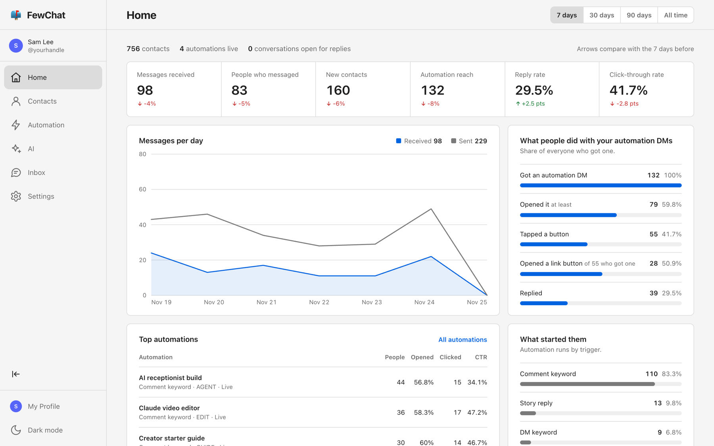
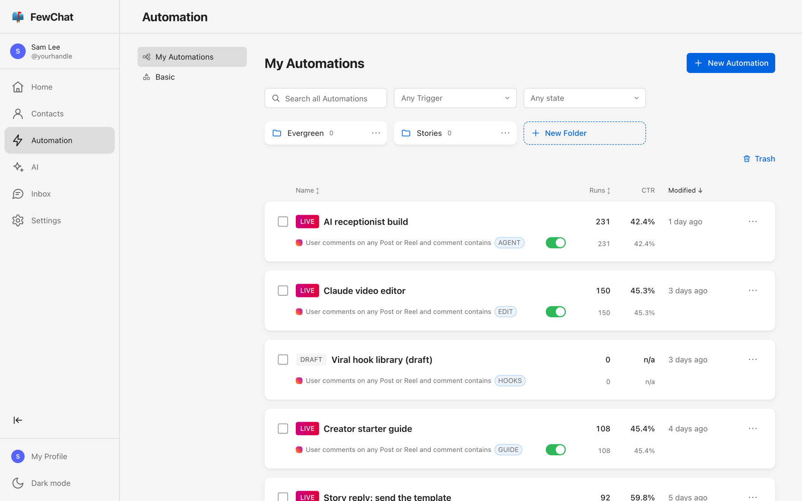
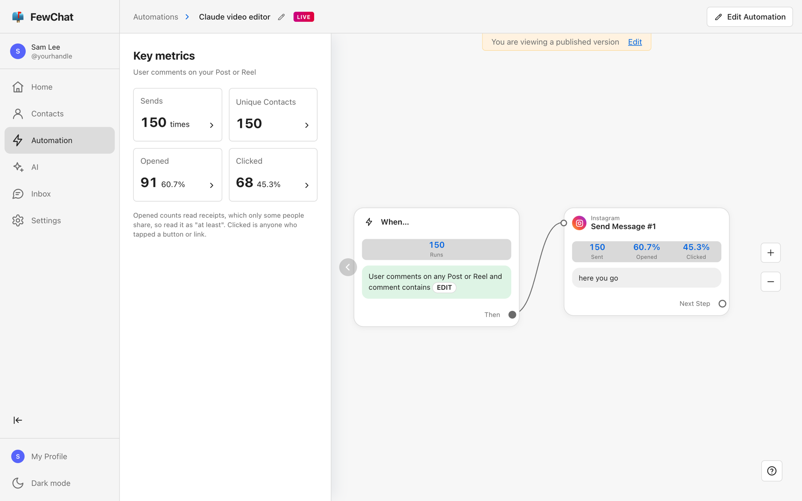
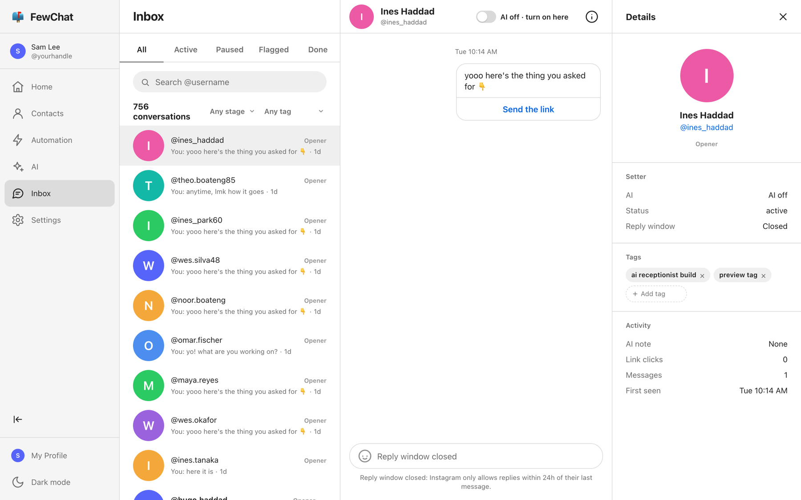
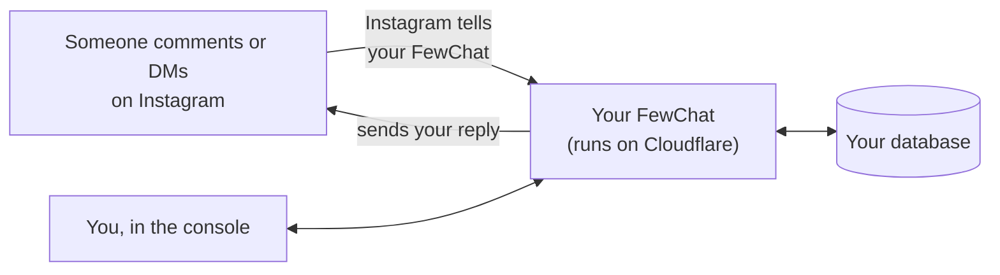

# 📫 FewChat

**Instagram DM automation you own.** Someone comments a keyword on your reel, and they get your DM with the link, in about a second. Story replies, DM keywords, a visual flow builder, a live inbox and your numbers are all included.

It's open source and runs on your own Cloudflare account through Instagram's official API. Your contacts and conversations sit in your own database, and there is no per-contact pricing. If you've used Manychat for Instagram, you'll know your way around: FewChat is a self-hosted alternative for one Instagram account.

**You don't need to know how to code.** One command sets it up and tells you what to click.

> [!NOTE]
> **Running FewChat costs $5 a month.** The software is free, and so is setting it up and trying it out, but real use needs Cloudflare's Workers Paid plan. See [What it costs](#what-it-costs), with a note from Jason.



<sub>Screenshots show made-up sample data. You can open the same console on your own computer with `npm run preview`.</sub>

## What it does

- **Comment-to-DM.** Someone comments your keyword on a post or reel and gets your DM, plus an optional public reply under their comment. Works on one post, every post, or the next one you publish.
- **Story and DM automations.** Trigger on a reply to your story, a story mention, a keyword in a DM, or someone's first message.
- **A visual flow builder.** Messages with buttons and quick replies, delays, conditions, A/B splits and tags, drawn as cards on a canvas. Drafts save themselves; Publish makes them live.
- **Inbox.** Every conversation live in one place, with photos, voice notes and reactions. Reply by hand any time.
- **Contacts and tags.** Everyone who messaged or commented, searchable.
- **Metrics.** Messages, people reached, reply rate, click-through rate and your top automations.
- **Reliable sending.** Messages queue under Instagram's hourly limit and retry, missed comments are picked up, and your phone can get an alert if something keeps failing.
- **AI replies (beta, optional).** An assistant that answers DMs in your voice. Off by default. Everything above works without it.

| Your automations | One automation, with its numbers |
| --- | --- |
|  |  |



## What you need

| | Cost | Notes |
| --- | --- | --- |
| An Instagram **professional** account | Free | Business or Creator. Switch in the Instagram app: Settings → Account type and tools. |
| A Facebook account | Free | Used once, to register your own app with Meta. Instagram requires that for any DM tool. |
| A Cloudflare account | $5 a month | This is where FewChat runs. Setup creates the account with you. Setting up and trying FewChat is free; real use needs Workers Paid. See [What it costs](#what-it-costs). |
| A computer with Node.js 22+ | Free | Mac, Windows or Linux. Get it from [nodejs.org](https://nodejs.org) (the big "LTS" button). |

Set aside about 45 minutes. Most of it is clicking through Meta's developer site, and setup gives you a page with every click and your own values filled in.

## What it costs

FewChat is free and open source. Running it takes **Cloudflare's Workers Paid plan, $5 a month**. Instagram and Meta charge nothing, and the optional AI replies cost a few cents per conversation, paid to Anthropic.

**A note from Jason.** In the reel where I showed FewChat, I said it was free. That was my mistake. I thought Cloudflare's free plan would be enough for smaller accounts without much traffic, and it isn't. Setting FewChat up and trying it out is free. But if you want to really use it and move your automations over from Manychat, you'll need the $5 plan.

**Why the free plan isn't enough.** It stops every run after 10 milliseconds of processing. FewChat's every-minute job (delays longer than 15 seconds, follow-ups, retries, broadcasts, phone alerts, picking up missed messages) needs more than that once an account is in real use, so Cloudflare cuts it off and those parts quietly stop working. The free plan also caps the database at 5 million rows read and 100,000 written a day, and a real inbox goes through that.

**How it compares with Manychat** (US prices on [manychat.com/pricing](https://manychat.com/pricing), November 2026):

- Manychat's cheapest paid plan, Essential, is $14 a month billed yearly, or $17 month to month, for 250 active contacts (the people you interact with in a month).
- Manychat's price climbs with your active contacts. On monthly billing, 7,500 a month costs $99, 25,000 costs $199 and 50,000 costs $299, each on its cheapest plan with extra contacts billed per person.
- Cloudflare doesn't charge per contact. Workers Paid includes 10 million requests and 25 billion database rows read a month, and anything past that is billed by usage (a tenth of a cent per million extra rows read), not by contacts. The account FewChat was built on talks to about 7,700 people a month, and its Cloudflare bill is $5 plus tax.

To upgrade: [dash.cloudflare.com](https://dash.cloudflare.com) → Workers & Pages → Plans → Workers Paid.

## Set it up

### 1. Get the code

Open a terminal. On a Mac that's the **Terminal** app; on Windows, **PowerShell**. Then paste:

```bash
git clone https://github.com/jasonc00person/fewchat.git
```

```bash
cd fewchat
```

No `git`? Install it from [git-scm.com](https://git-scm.com) and run the two lines again. (The green **Code** button → **Download ZIP** also works, but `npm run update` needs git to fetch new versions.)

### 2. Run setup

**The easiest way** is with [Claude Code](https://claude.com/claude-code). Start it in the folder and say what you want:

```bash
claude
```

Then type **set this up**. Claude runs everything, explains each step in plain words, and walks you through the parts that need your hands.

**Or run it yourself.** It asks three questions and does the rest:

```bash
npm run setup
```

Either way, you can stop at any point. Run it again and it continues where it left off.

### What setup does, and what you do

| Setup does this for you | You do this |
| --- | --- |
| Installs FewChat's tools | Answer three questions: your Instagram username, your name or business, a contact email |
| Creates your database and message queue on Cloudflare | Click **Allow** when Cloudflare opens in your browser |
| Builds every database table | |
| Makes your passwords and stores them safely | |
| Puts FewChat live on your own address | |
| Writes **MY-SETUP.md**: your console address and password, and every Meta click with your values filled in | Follow its steps on Meta's site (about 15 minutes; with Claude in Chrome, Claude clicks through them for you), then paste the App secret back |
| Checks that Instagram can reach your FewChat | Click **Log in with Instagram** on your new console |
| Waits for your first test message to arrive | Send your account a DM from another account |

### 3. Check it

```bash
npm run check
```

It looks at your live setup and tells you, in plain words, what works and what to fix.

## Your first automation

1. Open your console (the address is in `MY-SETUP.md`) and click **Automation** → **New Automation**.
2. Pick the template **Comment keyword → DM link** (or **Start from scratch** and choose the trigger **User comments on your Post or Reel**). Pick the post and type a keyword such as `GUIDE`.
3. Click the message card and write the DM. Put your link on its button.
4. Click **Test**. It gives you a 3-digit code: DM that code to your account from another account to see the whole flow, as often as you want.
5. Click **Publish**. From now on, everyone who comments the keyword gets the DM.

## How it works, in plain words



- **Instagram tells your FewChat** the moment someone comments or messages. That notification is called a *webhook*.
- **Your FewChat** is a small program running on Cloudflare (they call it a *Worker*). It's always on. Your computer can be off.
- It looks for an automation that matches, and **sends your reply** through Instagram's official API.
- Everything is saved in **your database**, also on your Cloudflare account.
- **The console** is the website where you build automations, read your inbox and see your numbers.

The longer tour, with a glossary: [docs/HOW-IT-WORKS.md](docs/HOW-IT-WORKS.md).

## Everyday commands

Run these in the `fewchat` folder.

| Command | What it does |
| --- | --- |
| `npm run check` | Is everything working? Says what's wrong and how to fix it. |
| `npm run update` | Gets the newest FewChat and puts it live. Your settings are never touched. |
| `npm run setup` | Run it again after changing a setting or adding a key. It's always safe. |
| `npm run preview` | Opens a practice console on your own computer with made-up sample data. Nothing is sent. |

## Where your stuff lives

These files are yours. Git ignores them, so updates never overwrite them and they're never uploaded by accident.

| File | What's in it |
| --- | --- |
| `fewchat.config.json` | Your answers: Instagram username, business name, your link |
| `.env` | Your passwords and keys. Never share it. |
| `MY-SETUP.md` | Your console address, your password and your Meta steps. Never share it. |
| `src/prompt.ts`, `src/knowledge.ts` | The AI's script, if you turn the AI on |

## Getting updates

```bash
npm run update
```

This gets the newest FewChat, applies any database changes it brings and puts the new version live. The files above are never touched.

**Forked it on GitHub?** Your folder gets its updates from your fork, not from this repo. Open your fork on GitHub and click **Sync fork** first, then run `npm run update`. If you haven't synced, `npm run update` just says "Already up to date".

**Changed FewChat's code yourself?** When an update changes a file you edited, `npm run update` stops before changing anything. You'll see "Not possible to fast-forward" or "Your local changes would be overwritten". Your live FewChat keeps running the version you have. To combine your changes with the update:

```bash
git add -A && git commit -m "My changes"
```

```bash
git pull --no-rebase
```

Then run `npm run update` again. Git combines the two by itself and only stops at the lines that both you and the update changed, so you can pick what stays. With Claude Code or another AI agent, just ask it to "merge the latest FewChat update and keep my changes".

**The AI's script stays yours.** `src/prompt.ts` and `src/knowledge.ts` were copied from `templates/` when you set up, so updates never change them. When `templates/prompt.ts` gets better, compare it with your copy and bring over what you want.

## Questions

**Do I need to code?** No. Setup is one command, and automations are built by clicking in the console.

**What does it cost?** $5 a month for Cloudflare's Workers Paid plan, which FewChat needs for real use. The software is free, and you can set it up and try it on Cloudflare's free plan. The optional AI replies cost a few cents per conversation, paid to Anthropic. More in [What it costs](#what-it-costs).

**Is this allowed by Instagram?** It uses only Instagram's official API, the same one other DM tools use, and follows its rules by design (see below). Staying inside them is still your responsibility.

**Where is my data?** In a database on your own Cloudflare account. Nobody else can see it, including the people who wrote FewChat.

**Can it run more than one Instagram account?** One account per install. For a second account, set it up again in a second folder with `npm run setup -- --name=fewchat-two`.

**Can it DM my new followers?** No. Instagram doesn't tell outside apps when someone follows you.

**Something isn't working.** Run `npm run check`, then see [docs/TROUBLESHOOTING.md](docs/TROUBLESHOOTING.md).

## AI replies (beta)

An optional assistant can answer DMs in your voice with Claude, from a script and facts you write. It's off by default, it can't be switched on until its script is written, and it's still a work in progress. How to turn it on: [docs/AI.md](docs/AI.md).

## Instagram's rules

- Automated messages only go out within 24 hours of the person's last message, comment or button tap. You can always reply by hand from the Instagram app.
- For an account you own, Meta's standard access is enough. You don't need App Review, but your Meta app has to be switched to **Live**.
- Buttons and quick replies show in the Instagram phone app, not on desktop.
- Some places require telling people a bot is replying. If you turn on AI replies, set `DISCLOSE` in `src/autonomy.ts` where that applies to you.
- Photos, voice notes and videos are fetched when you look at them and never stored, in line with Meta's Platform Terms.

## For developers

```bash
npm test            # the full suite, with real SQL through a local D1 shim
npm run typecheck
npm run deploy      # refuses while setup isn't finished
npx wrangler tail   # live logs
node scripts/fc.mjs # manage automations from the terminal (list, copy to your next post, publish, on/off, stats, broadcasts)
```

`wrangler.jsonc` and `src/brand.ts` are built from `templates/` and `fewchat.config.json` by `npm run setup` (and on `npm install`), and are git-ignored, as are `src/prompt.ts` and `src/knowledge.ts`. Forking to keep your own version in git? Delete those lines from `.gitignore`. [CLAUDE.md](CLAUDE.md) explains how the code is laid out.

Issues and pull requests are welcome. When you report a problem, include what `npm run check` prints. Never post your `.env` or `MY-SETUP.md`.

## License and trademarks

[MIT](LICENSE). Built by [@jasoncooperson](https://www.instagram.com/jasoncooperson/).

FewChat is an independent project. It is not affiliated with, endorsed by or sponsored by Manychat, Meta, Instagram, Cloudflare, Anthropic or Skool. Their names are trademarks of their owners and are used here only to say what FewChat works with or is an alternative to.
